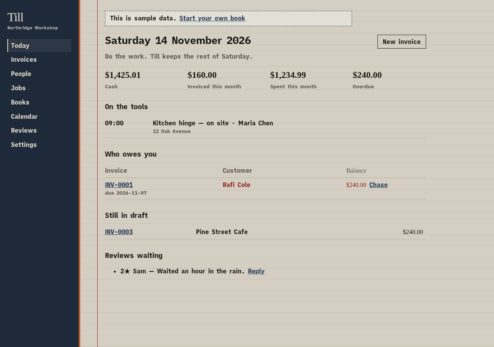
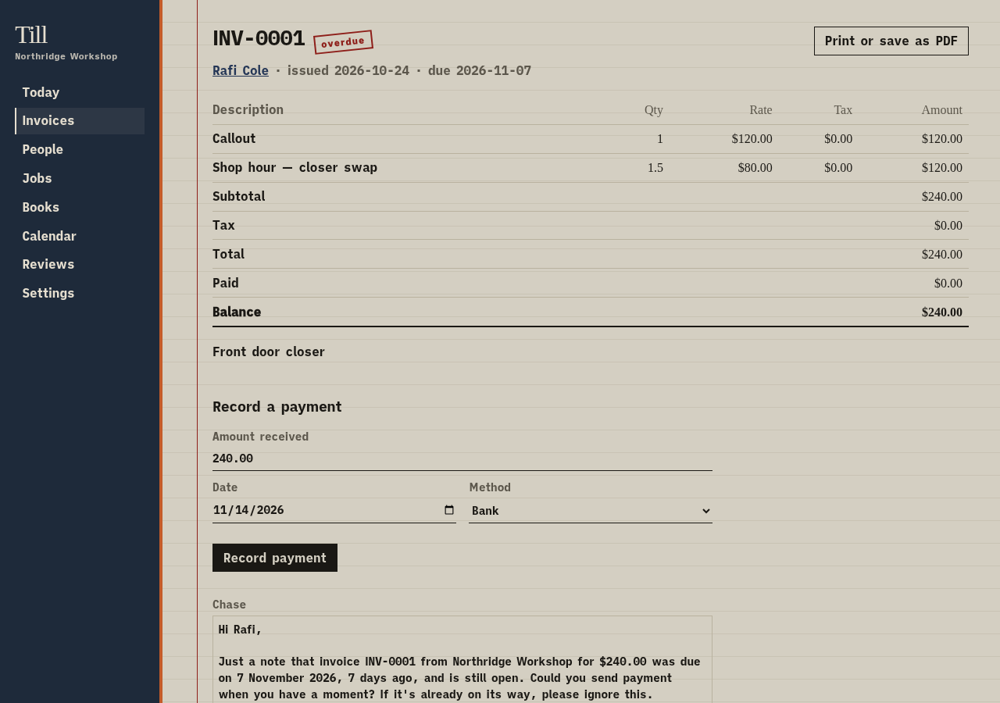
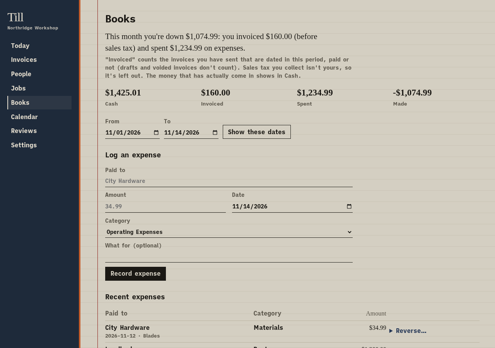
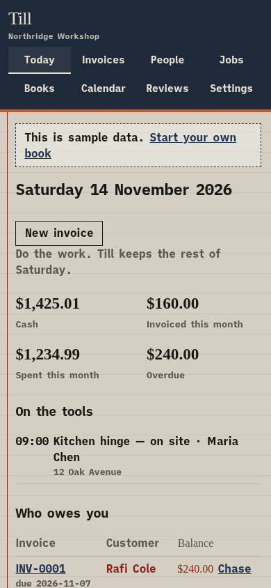

# Till

**Invoices, quotes and simple double-entry books for a one-person business, on your own computer.**

Till is for a sole trader or one-person service business: a handyman, a
plumber, a bike mechanic, a tutor, a freelance designer. You want to send
invoices, see who owes you, and know what you made this month, and you want
your books in a file on your own machine rather than in someone's cloud. It
runs in your browser at `http://127.0.0.1:7740/` and stores everything in
one SQLite file.



| An invoice | The books | On a phone |
|---|---|---|
| [](docs/screenshots/invoice.png) | [](docs/screenshots/books.png) | [](docs/screenshots/today-mobile.png) |

## What it does

- **Invoices and quotes**: draft, mark as sent, part-paid, paid, void. A
  quote converts into an invoice. A print view saves as a PDF from the browser.
- **Books**: every sent invoice, payment and expense is a balanced
  double-entry journal entry. Profit and loss, and money owed by age, are
  read from the journal. Mistakes are corrected by reversal, never by erasing.
- **Today**: cash, this month's income and spending, what's overdue (with
  a ready-to-send reminder email), drafts, and jobs on the calendar.
- **Customers, jobs and a calendar**. A job turns into an invoice in one
  click. The calendar exports as `.ics`.
- **Monthly retainers**: `till tick` issues the drafts that are due.
- **Reviews inbox**: paste in a review, write and keep your reply.
- **Your currency and tax rate**, set once in Settings.
- **A local JSON API** at `/api` for your own scripts, or an AI assistant if
  you use one (optional, see the end).

## What it deliberately doesn't do

- **No email sending.** "Mark as sent" records the invoice in the books;
  you print it or save it as a PDF and send it yourself. Reminder emails
  open in your own mail app.
- **No bank feeds, card payments or payroll.** You record payments and
  expenses as they happen.
- **One user.** No logins, no staff accounts, no sync between computers.
- **Sales-tax style tax only**: a percentage added on top, per line. No
  VAT-inclusive prices or tax returns.
- **Linux first.** See Requirements.

## Requirements

- **Linux.** That is where Till is built and tested.
- **Python 3.11 or newer.** Ubuntu 24.04 and Debian 12 are new enough;
  Ubuntu 22.04's Python 3.10 is not.
- On Debian and Ubuntu, the **`python3-venv`** package
  (`sudo apt install python3-venv`), or `python3 -m venv` fails.
- A web browser.
- **macOS** will probably work for `till serve`, but it is untested.
  `till install` (start on login) needs systemd, so it is Linux only.
  Windows is untested.

## Install

```bash
git clone <this repository's URL> till
cd till
python3 -m venv .venv
.venv/bin/pip install -e .
```

The commands below assume the virtual environment is active
(`source .venv/bin/activate`, once per terminal). Otherwise type
`.venv/bin/till` instead of `till`.

## Try it with sample data

```bash
till demo
```

This makes a sample business, "Northridge Workshop", with customers,
invoices (one overdue), expenses and a job today. It goes in its own file
(`data/demo.db`) and runs on its own port. Open
**http://127.0.0.1:7749/**, click around, and press Ctrl+C when you're
done. Nothing you do there touches your own book. `till demo --fresh`
starts the sample over.

## Start your real book

```bash
till serve
```

Open **http://127.0.0.1:7740/**. Your book starts empty, and Today shows
three steps: fill in your business details in **Settings** (name,
address, currency, tax, how customers pay you), **add a customer**, then
make a **new invoice**.

`till open` starts Till in the background if it isn't running and opens
your browser. Other commands:

```bash
till brief       # today's summary in the terminal
till tick        # issue drafts for retainers that are due
till doctor      # check the book balances and Till is answering
till --help
```

## Run it on login (optional)

On Linux with systemd you can have Till start when you log in, with a
**Till** entry in your app launcher:

```bash
till install            # --port N to use another port
till uninstall          # undo it; your books stay
```

This writes a systemd user service (`~/.config/systemd/user/till.service`),
a launcher (`~/.local/share/applications/till.desktop`) and a
`~/.local/bin/till` link. It writes nothing into this folder. It won't
replace a Till service installed from another folder, and it won't stop a
program already using the port. In both cases it tells you and changes
nothing. Without systemd, it says autostart isn't available, installs
nothing, and exits with status 1. `till serve` works the same either way.

## Backup and restore

```bash
till backup                  # writes data/backups/till-<date-time>.db
till backup ~/till-copy.db   # or wherever you like
till restore ~/till-copy.db  # the current book is moved aside first
```

`till backup` is safe while Till is running. Copy the backups somewhere
other than this computer now and then. `till restore` never deletes the
book it replaces: it saves a copy of it as
`data/backups/till-before-restore-<date-time>.db`, then moves its files,
exactly as they are, into `data/backups/till-replaced-<date-time>/`. It
refuses while Till is running or something else has the book open, or when
it can't tell (a file SQLite can't read, or a write left unfinished), unless
you pass `--force`; restart Till afterwards.

## Where your data is

One SQLite file: `data/till.db` inside this folder, or wherever `TILL_DB`
points. The sample business is `data/demo.db` (or `TILL_DEMO_DB`).
Settings → Advanced shows the path. `data/` is ignored by git, so
`git pull` never touches your books.

| Setting | Default | What |
|---|---|---|
| `TILL_DB` | `data/till.db` | your book |
| `TILL_PORT` | `7740` | port for `serve`, `open`, `install`, `doctor` |
| `TILL_DEMO_DB` | `data/demo.db` | the sample book |
| `TILL_DEMO_PORT` | `7749` | port for `till demo` |

## Security model

- Till listens on **127.0.0.1 only**. Other computers on your network
  can't reach it.
- **There is no login.** Anyone, or any program, with an account on this
  computer can open it and change the books. Use it on a computer that is
  yours.
- Other websites can't read or change your books through your browser.
  Changes coming from another site are refused, and so is any `Host`
  other than `127.0.0.1` or `localhost`, which blocks DNS-rebinding tricks.
  The API only accepts JSON bodies, so a web form can't post to it.
- Till makes no outside network requests of its own. Your books stay on
  this computer unless you copy them somewhere.

## The API, for scripts and AI assistants (optional)

Everything Till does is available as JSON under `/api` on the same port:
`/api/today`, `/api/invoices`, `/api/customers`, `/api/books/pnl`,
`/api/books/aging`, `/api/expenses`, `/api/reviews` and more. Money is
integer cents and quantities are thousandths (`qty_milli: 1500` is 1.5
hours). POST bodies must be `application/json`. Errors come back as
`{"detail": "..."}`. The full reference, with examples, is
[`skills/till/SKILL.md`](skills/till/SKILL.md).

### Using it with an AI assistant (Hermes)

Till doesn't need an AI to work. If you use the Hermes assistant,
`skills/till` is a skill for it. Its rules say that text read from Till
(reviews, customer names, notes) is never treated as instructions, and
that the assistant must get your yes before it changes anything. Link it
with `till install --hermes`, or by hand:

```bash
ln -s "$PWD/skills/till" ~/.hermes/skills/productivity/till
```

`till telegram-brief` sends today's summary through Hermes's Telegram
connection. Any other assistant that can make HTTP requests can use the
same API.

## Development

```bash
.venv/bin/pip install -e '.[dev]'
.venv/bin/pytest
```

The tests use temporary books. The installer tests run against a fake
home directory and a fake `systemctl`, so they never touch your real
login session.

## Licence

MIT. Use it, change it, share it or sell it; keep the licence text with it. See [LICENSE](LICENSE).
